<div align="center">

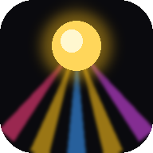

# LUMA DESK

**A grandMA-style stage lighting console with a real-time 3D concert stage at Sultan's Pool, Jerusalem. It runs entirely in the browser.**

### [▶ Open the app](https://gilad1987.github.io/luma-desk/)

No install and no build step. Works offline once loaded, and can be installed as an app on desktop or iPad.

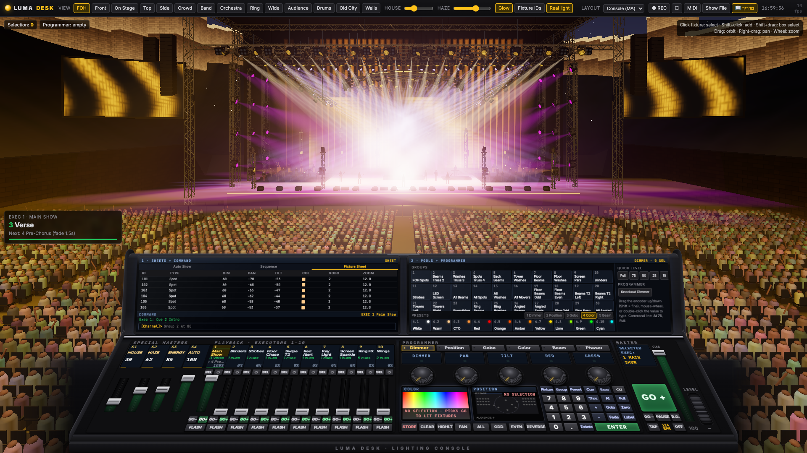

</div>

---

## Highlights

|                                                                                                                 |                                                                                                           |
| --------------------------------------------------------------------------------------------------------------- | --------------------------------------------------------------------------------------------------------- |
| 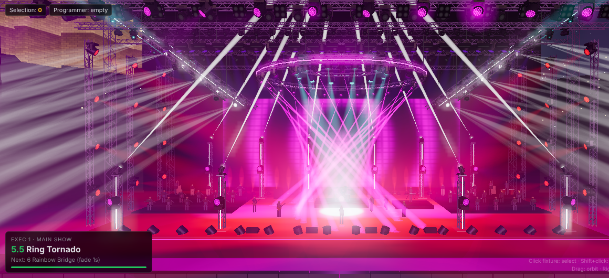                                                              | 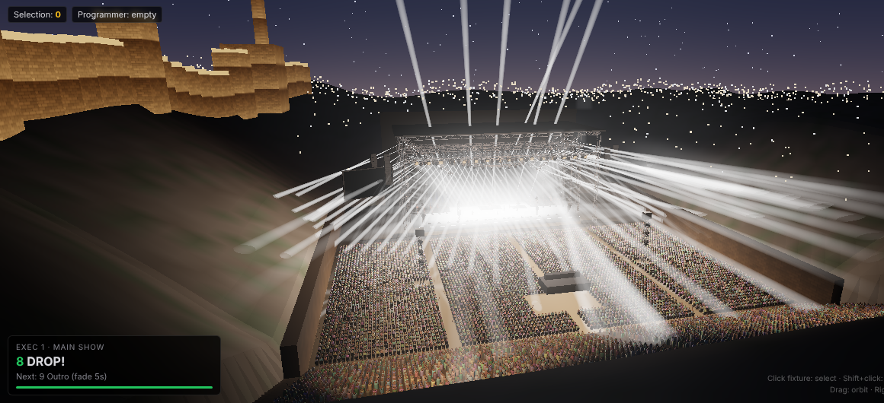                                                        |
| **Circular truss "tornado"**: 24 beams on a ring, twisted with a Circle phaser and 360° phase spread.           | **The drop**: strobes, blinders, sunburst ring and fanned beams across the whole rig.                     |
| 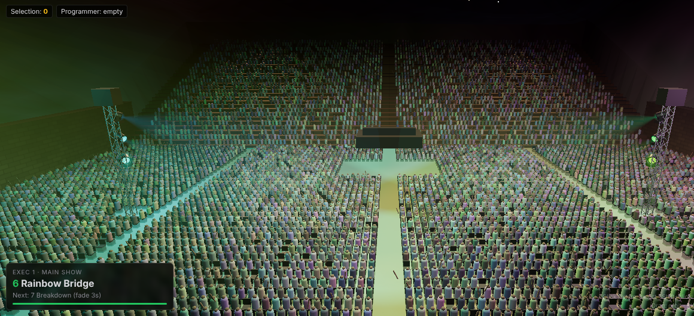                                                                 | 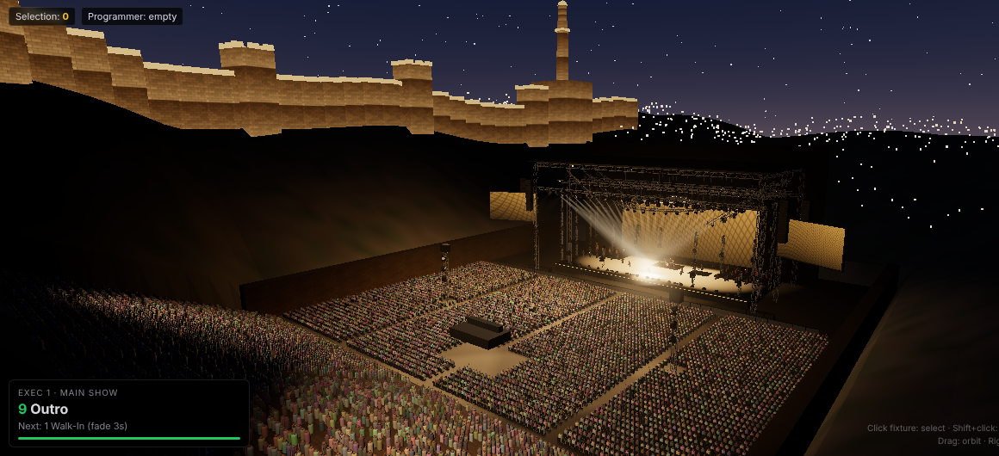                                    |
| **The crowd gets lit**: every beam that lands in the audience colors the people under it.                       | **Sultan's Pool**: seated crowd, stone terraces, and the floodlit Old City walls with the Tower of David. |
| 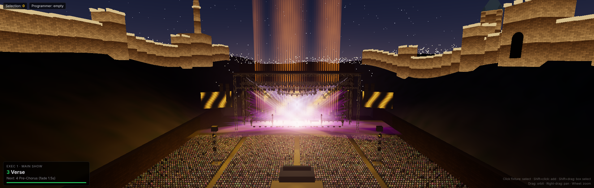                                            | 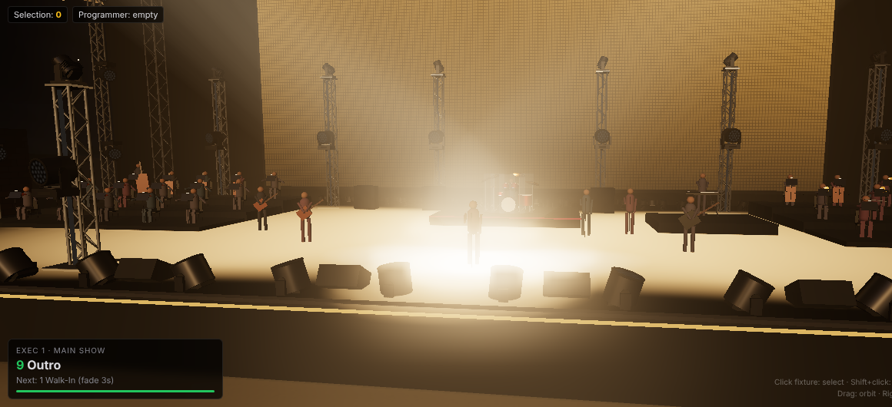                                                           |
| **Jerusalem's walls on both sides** of the valley, with a gate on the right and the Tower of David on the left. | **8-piece band** with a full drum kit on the riser.                                                       |
| 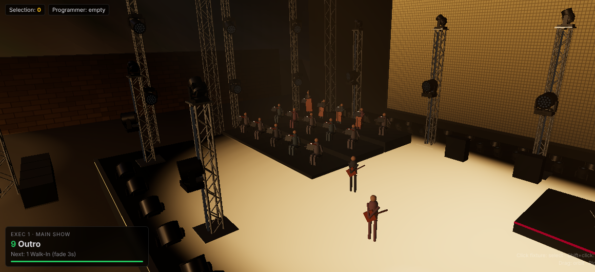                                                           | 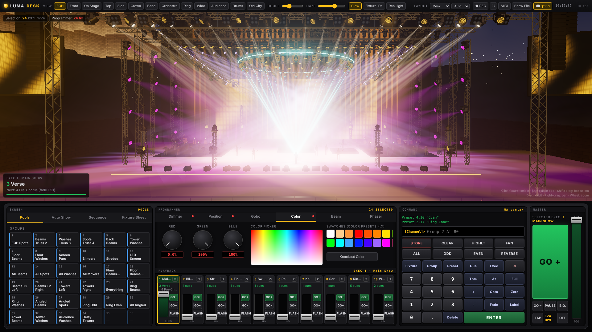                                                 |
| **30-piece orchestra** on three tiers of risers.                                                                | **Programmer**: feature keys, encoders and on-screen tools.                                               |

## Features

### 🎛 Console (grandMA workflow)

- **Console (MA) layout** (the default): a physical lighting desk drawn in 3D perspective, standing on the front-of-house control platform in the audience. The FOH view is the operator's eye behind the console, so you see the crowd and the stage over its screens. The screen housing stands up with side cheeks, the control surface slopes toward you, and every control stays live. Drag the grip on top of the screens to make the console larger or smaller (double-click resets it). It has two large screens (1 Fixture Sheet / Sequence / Auto Show + command line, 2 Pools + Programmer tools) above a control surface. The fader wing has one wide LCD over 4 gold-cap special masters (House, Haze, Energy, Auto master) and 10 executors with select, off, GO and flash keys. The programmer side has lit feature keys, five live encoders with value displays, two small touch screens (color picker and focus pad), a hardware MA keypad (`Group 2 4 At Full ENTER`), and a GO / Grand Master section with a level wheel. It fits any window, so everything stays in reach even on a 4K monitor. The **Desk** (compact flat) and **Classic** layouts are also available.
- **Command line** in MA syntax: `Fixture 201 Thru 230`, `Group 24 + Group 31`, `At Full`, `Store Cue 5 Fade 3`, `Goto Cue 3`, `Preset 4.10`, `Label Cue 5 Chorus`, `Delete Cue 4`, `Off Exec 2`.
- **Programmer** with feature tabs (Dimmer, Position, Gobo, Color, Beam, Phaser), drag encoders, and programmer values shown in red.
- **Pools**: 48 group slots, and presets for Dimmer, Position, Gobo, Color and Beam. Position presets are calculated per fixture: Singer, Drums, Orchestra, Fan Audience, Ring Cone, Ring Twist, Sunburst, Crown and more.
- **Focus pad**: click a stage map to aim the whole selection at a point.
- **Phasers**: Circle, Pan, Tilt, Ballyhoo, Dim Wave, Dim Chase, Swipe, Random Flash, Rainbow and Color Chase, with Rate, Size and Phase controls. All sync to **TAP** tempo.
- **10 executors** with faders, GO+, GO−, FLASH and OFF. Cue lists with **tracking** and fades, HTP dimmer and LTP for everything else, plus Grand Master, Blackout, Highlight, FAN and ODD/EVEN.


### 🤖 Auto Show

Nine automatic lighting styles: **EDM, Techno, Rock, Pop, Hip-Hop, Mizrahi/Party, Ballad, Orchestral and Cinematic**. Each style generates looks on the bar and follows a song structure (verse, chorus, build, drop). You can control energy, change rate and beat pulse. Load an MP3 and the BPM is detected automatically, so the lights and the crowd lock to the music. Any look can be saved as a cue, or turned into a full 8-cue list.

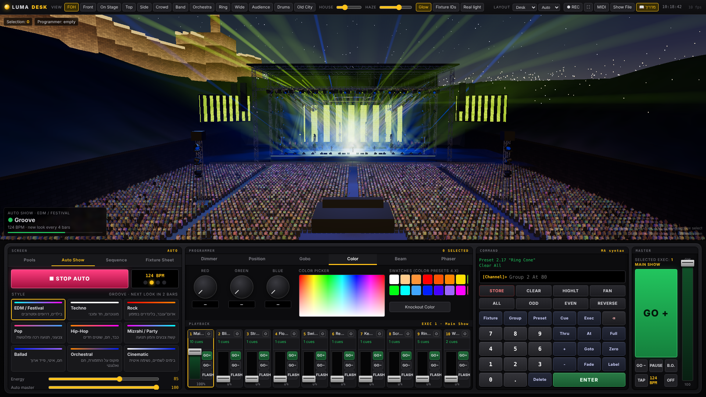

### 💡 The rig: 405 fixtures

Every fixture is a 3D model of a real product:

| Type        | Model                                         |
| ----------- | --------------------------------------------- |
| Spot        | Robe FORTE                                    |
| Beam        | Robe MegaPointe                               |
| Wash        | Robe Spiider                                  |
| Strobe      | Robe WTF!                                     |
| Blinder     | Chauvet STRIKE 4                              |
| LED Par     | Robe ParFect 150                              |
| LED Bar     | Robe Tetra2 (tilt only)                       |
| Follow Spot | Robe FORTE FS, with a RoboSpot station at FOH |
| Profile     | ETC Source Four (static)                      |

| IDs       | Type        | Position                                                       |
| --------- | ----------- | -------------------------------------------------------------- |
| 101–120   | Spot        | Front truss (FOH)                                              |
| 201–230   | Beam        | Truss 2                                                        |
| 301–330   | Wash        | Truss 3                                                        |
| 401–420   | Spot        | Truss 4                                                        |
| 501–530   | Beam        | Back truss                                                     |
| 601–624   | Wash        | Side ladders                                                   |
| 701–740   | Beam        | Floor, upstage                                                 |
| 801–816   | Blinder     | Front truss                                                    |
| 901–920   | Strobe      | Truss 3                                                        |
| 1001–1016 | Wash        | Floor, downstage                                               |
| 1101–1120 | LED Par     | Under the LED wall                                             |
| 1201–1224 | Beam        | Circular truss (outer ring)                                    |
| 1301–1312 | Wash        | Circular truss (inner ring)                                    |
| 1401–1424 | Beam        | Six angled flown trusses                                       |
| 1501–1512 | Spot        | Angled trusses (middle pair)                                   |
| 1601–1610 | Beam        | Standing light towers (top)                                    |
| 1701–1710 | Wash        | Standing light towers (middle)                                 |
| 1801–1818 | Wash        | Audience light: front truss and delay towers                   |
| 1901–1904 | Follow Spot | Front truss, between the FOH spots                             |
| 2101–2112 | LED Bar     | Floor, downstage edge                                          |
| 2201–2212 | Profile     | Side ladders                                                   |
| 2001      | LED wall    | 35 × 13 m LED wall and IMAG side screens, with 8 content modes |

Four Antari HZ-500 hazers stand upstage. Their haze puff follows the **Haze** master.

Rendering includes volumetric beams in moving haze, gobo projections in the beam and on the floor, lens glow, pixel LED strips on the ring, angled trusses and towers, real spot lights with soft shadows on the performers, and a seated crowd of about 9,000 that bounces to the beat.

### 📱 App

- **Installable PWA**: use **⬇ Install** in Chrome or Edge, or **Add to Home Screen** on iPad and iPhone. It opens in its own window and **works offline**.
- **● REC** records the stage view to a video file (WebM), including the loaded song.
- **Show files**: download and load `.json` shows. The current show also auto-saves in the browser.
- **Web MIDI**: CC 1–10 control faders 1–10, CC 0 controls the Grand Master, and notes 36–45 are GO on executors 1–10.
- **Full screen** with the `F` key.
- **Built-in Hebrew guide** with 12 chapters and a 17-step guided tour of the screen.

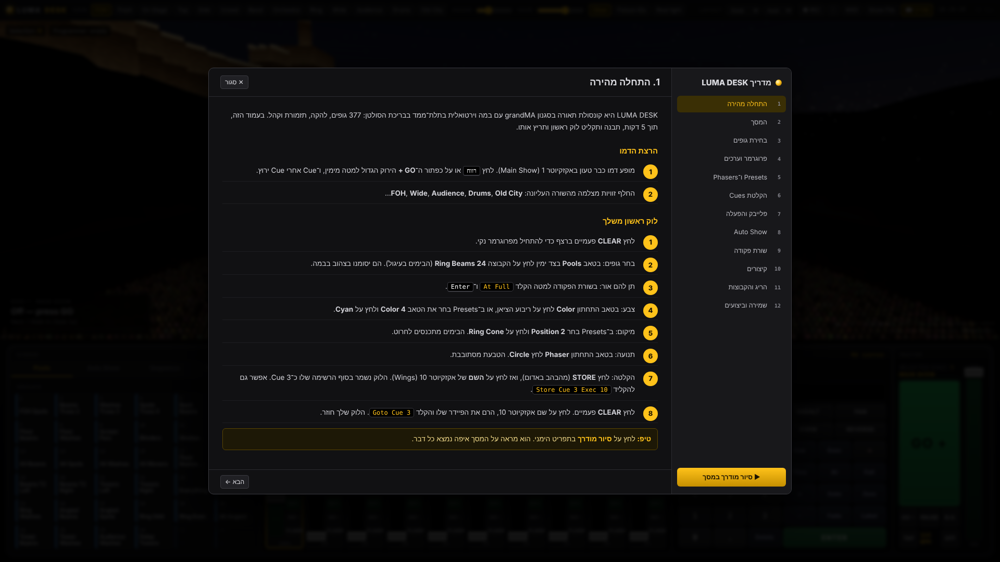

## Quick start

1. Open the app. The demo show is loaded on executor 1.
2. Press **Space** or the big green **GO +** to step through the cues.
3. Switch camera views from the top bar: FOH, Wide, Ring, Audience, Drums, Old City and more.
4. Open **📖 מדריך** (the guide) for the full manual and the guided tour.

## Keyboard

| Key                              | Action                                 |
| -------------------------------- | -------------------------------------- |
| `Space`                          | GO+ on the selected executor           |
| Any letter or number             | Type into the command line             |
| `Enter` / `↑` / `↓`              | Run a command / browse command history |
| `F`                              | Full screen                            |
| `Esc`                            | Cancel STORE / close dialogs           |
| `Shift` + click or drag on stage | Add to selection / box select          |

## Run locally

Node 26 (see `.nvmrc`) and npm:

```bash
git clone https://github.com/gilad1987/luma-desk
cd luma-desk
npm ci            # install the pinned tools from the lockfile
npm run dev       # dev server with hot reload (no service worker)
npm run build     # production build into dist/
npm run preview   # serve dist/ as GitHub Pages would
```

`npm ci` also installs the git hooks (`prepare`); the pre-commit hook runs ESLint and Prettier on the staged files.

Checks (CI runs `typecheck`, `lint`, `test`, `build` and `test:e2e:ci`; the others are for local use):

```bash
npm run typecheck   # tsc over the app, tests, configs and the service worker
npm test            # Vitest unit and parity tests (npm run test:watch to re-run on change)
npm run lint        # ESLint, the 100-line check, the no-JS check and Prettier --check
npm run lint:fix    # ESLint --fix, then Prettier --write
npm run format      # Prettier --write over the tree
npx playwright install chromium   # once
npm run test:e2e                  # whole browser parity suite against the production preview
npm run test:e2e:ci               # the same without the @screenshot tests (what CI runs)
npm run test:screenshots          # only the @screenshot tests
```

**Screenshots are a local macOS check.** The screenshot baselines are recorded on macOS, and fonts and WebGL draw
differently on Linux, so CI skips the `@screenshot` tests. Run `npm run test:screenshots` on macOS before a change
that can move a pixel, and state the result in the PR. `npm run test:e2e:update` records new baselines; only the
orchestrator approves them.

## Deploy

`.github/workflows/deploy.yml` checks every pull request and deploys `main` to GitHub Pages
([ADR 0004](docs/adr/0004-actions-deploy.md)). The Pages source changes from the `gh-pages` branch to the workflow
once, after the refactor is merged, and only with the owner's approval. Run the steps in this order. Step 1 is
needed because the `github-pages` environment allows only the `gh-pages` branch, so a deploy from `main` is rejected
until `main` is added.

```bash
# 1. Allow main to deploy to the github-pages environment
gh api -X POST repos/gilad1987/luma-desk/environments/github-pages/deployment-branch-policies -f name=main -f type=branch
# 2. Switch the Pages source to the workflow
gh api -X PUT repos/gilad1987/luma-desk/pages -f build_type=workflow
# 3. Deploy main
gh workflow run deploy.yml --ref main
```

Then check the result:

```bash
gh api repos/gilad1987/luma-desk/pages --jq .build_type   # prints: workflow
gh run list --workflow deploy.yml --branch main --limit 1 --json conclusion --jq '.[0].conclusion'   # prints: success
```

Open https://gilad1987.github.io/luma-desk/ and make sure that it serves the new build.

## Performance

LUMA DESK is GPU-heavy, so use Chrome or Edge on a machine with a dedicated graphics card. If it stutters, turn off **Real light** and **Glow** in the top bar, or lower **Haze**.

## Tech

- TypeScript 5.9 (strict) built with Vite 8. The code is split into one-way layers under `src/`; see
  [docs/ARCHITECTURE.md](docs/ARCHITECTURE.md) and the decision records in [docs/adr/](docs/adr/).
- [three.js](https://threejs.org) 0.160 from npm (MIT), with UnrealBloom post-processing.
- Custom GLSL shaders for volumetric beams with procedural haze, gobos and the LED wall.
- Styles in SCSS, compiled by Vite with `sass-embedded`.
- Tests: Vitest for unit and parity tests, Playwright (Chromium with SwiftShader WebGL) for golden outputs,
  screenshots, old saved shows and offline use.
- ESLint 9 with typescript-eslint, and Prettier 3.
- A hand-written service worker (`sw.ts`) caches the app for offline use; the build writes in its file list and
  cache name. `manifest.webmanifest` makes the app installable.
- Odd behaviour kept on purpose during the refactor is listed in [docs/known-quirks.md](docs/known-quirks.md).

---

<div dir="rtl">

## בעברית

**LUMA DESK** היא קונסולת תאורה בסגנון grandMA עם במה וירטואלית בתלת־ממד בבריכת הסולטן בירושלים. היא כוללת 405 גופי תאורה, להקה, תזמורת של 30 נגנים וקהל יושב, והכול רץ בדפדפן.

- **פתיחה:** https://gilad1987.github.io/luma-desk/
- **התקנה כאפליקציה:** כפתור **⬇ התקן אפליקציה** בשורה העליונה (Chrome או Edge), או **הוסף למסך הבית** באייפד.
- **מדריך מלא בעברית וסיור מודרך:** כפתור **📖 מדריך** באפליקציה.

</div>
